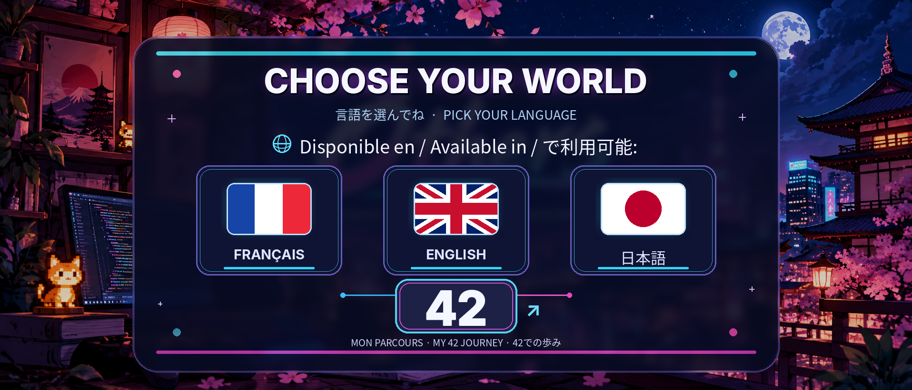

  

<!--
Le visuel ci-dessus est un SEUL PNG : aucune coupure visuelle.
Pour que chacun des trois drapeaux et le logo 42 soit cliquable directement dans l'image,
ouvrir le lien GitHub Pages (lien de l'image). Les zones cliquables sont définies dans index.html.
Le README GitHub ne permet pas les zones HTML <map>/<area> ni les superpositions CSS personnalisées.
Le domaine Pages ne fonctionnera qu'après son activation dans Settings > Pages.
-->
